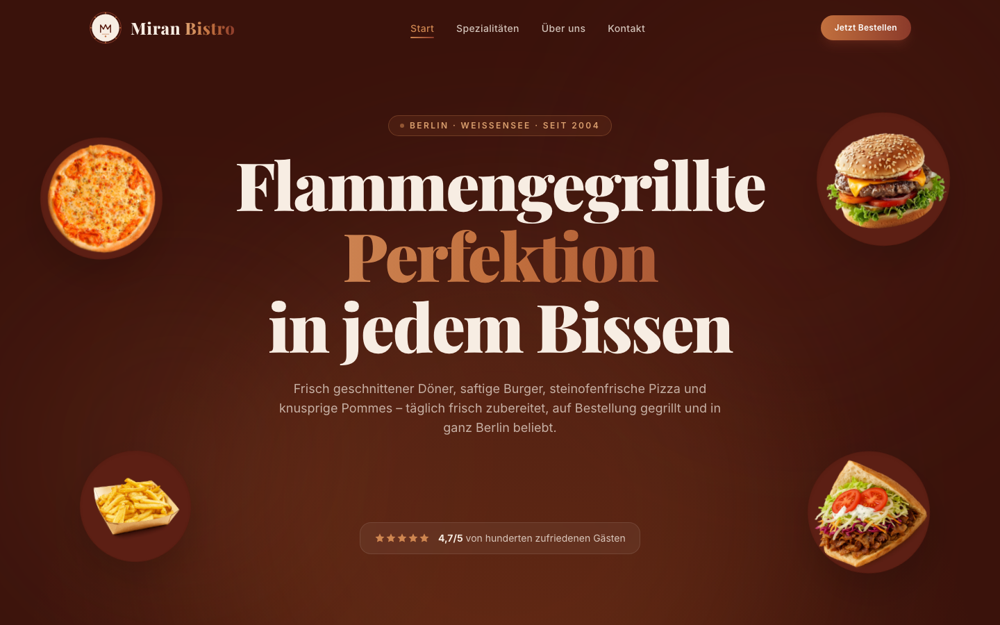

# Miran Bistro | Restaurant Website

A modern, animated restaurant website built for **Miran Bistro**, a family-owned doner & grill spot in Berlin-Weissensee serving the neighborhood since 2004.

**Live site:** [simple85.github.io/Miran-Bistro-Website](https://simple85.github.io/Miran-Bistro-Website/)

[](https://github.com/simple85/Miran-Bistro-Website/actions/workflows/ci.yml)


---

## Preview

<p align="center">
  
</p>

---

## Highlights

- **Scroll-driven animations** · GSAP + ScrollTrigger power a pinned food showcase that crossfades between dishes with parallax depth, floating food elements that react to mouse movement, and staggered reveal animations throughout.
- **Smooth scrolling** · Lenis provides buttery-smooth native scroll with momentum, integrated with GSAP's ScrollTrigger for frame-perfect sync.
- **Fully static export** · The site compiles to pure HTML/CSS/JS via `next export`, deployable to GitHub Pages with zero server costs.
- **Custom design system** · A warm, dark-themed palette (deep wine, ember, flame, copper, cream) with custom Tailwind tokens, gradient text utilities, glassmorphism cards, and custom scrollbar styling.
- **Responsive & mobile-first** · Fluid typography, collapsible hamburger nav, responsive grid layouts, and touch-friendly interactions down to 375px.
- **SEO-optimized** · Open Graph metadata, semantic HTML, structured headings, and German-language content with proper `lang` attributes.
- **Tested** · Jest + React Testing Library for components and menu data, Playwright end-to-end tests against the real static export on desktop Chrome and iPhone Safari.
- **CI/CD pipeline** · GitHub Actions runs type checks, unit and E2E tests on every push, then deploys to GitHub Pages.

## Pages

| Route | Description |
|-------|-------------|
| `/` | Hero with parallax food floaters, promise strip, scroll-pinned food showcase, featured menu items, Google reviews |
| `/menu` | Full categorized menu (Doner, Burger, Pizza, Grill, Snacks) with dietary tags and pricing |
| `/about` | Restaurant story, team, and values |
| `/contact` | Location, opening hours, embedded map, phone |

## Tech Stack

| Layer | Technology |
|-------|-----------|
| Framework | **Next.js 15** (App Router, static export) |
| UI | **React 19**, **TypeScript** |
| Styling | **Tailwind CSS 3** with custom design tokens |
| Animations | **GSAP** (ScrollTrigger, timelines, parallax) |
| Scroll | **Lenis** smooth scroll |
| Fonts | Playfair Display (headings) + Inter (body) via Google Fonts |
| Testing | **Jest**, **React Testing Library**, **Playwright** |
| Deploy | **GitHub Pages** via GitHub Actions |

## Getting Started

```bash
# Clone the repository
git clone https://github.com/simple85/Miran-Bistro-Website.git
cd Miran-Bistro-Website
```

```bash
# Install dependencies
npm install
```

```bash
# Start the development server
npm run dev
```

Open [http://localhost:3000](http://localhost:3000) in your browser.

### Build for Production

```bash
# Generate the static export
npm run build
```

The output is written to the `out/` directory, ready to be served by any static host.

## Testing

```bash
npm test             # unit + component tests (Jest)
npm run test:e2e     # end-to-end tests (Playwright) against the static export
```

| Layer | What it covers |
|-------|----------------|
| Data | Menu integrity: categories, unique dishes, price format, and that every referenced photo exists |
| Components | Menu card badges (popular, vegan, vegetarian, spicy), navbar links, active page, mobile menu |
| Helpers | GitHub Pages base-path handling, contact links |
| End-to-end | Every page renders with no console errors, menu anchors, `tel:` link, order button, navigation (including the mobile menu), no broken images |

Run `npx playwright install` once before the first E2E run.

## Project Structure

```
├── app/
│   ├── layout.tsx          # Root layout with fonts, navbar, footer
│   ├── page.tsx            # Home page
│   ├── globals.css         # Tailwind layers, custom utilities, scrollbar
│   ├── about/              # About page
│   ├── menu/               # Full menu page
│   └── contact/            # Contact page
├── components/
│   ├── Hero.tsx            # Parallax hero with floating food & mouse tracking
│   ├── FoodScroll.tsx      # Scroll-pinned food showcase with crossfade
│   ├── Navbar.tsx          # Responsive navbar with scroll-aware blur
│   ├── Footer.tsx          # Multi-column footer with order links
│   ├── Reviews.tsx         # Google review cards
│   ├── MenuCard.tsx        # Menu item card with dietary badges
│   ├── OrderCTA.tsx        # Delivery platform call-to-action
│   ├── Reveal.tsx          # Scroll-triggered reveal animation wrapper
│   ├── CountUp.tsx         # Animated number counter
│   ├── SmoothScroll.tsx    # Lenis smooth scroll provider
│   └── food/              # Food image components
├── __tests__/              # Jest unit & component tests
├── e2e/                    # Playwright end-to-end tests
├── lib/
│   ├── menu.ts             # Typed menu data (categories, items, dietary flags)
│   ├── links.ts            # External links & contact info
│   └── asset.ts            # Base path helper for GitHub Pages
├── public/
│   ├── food/               # Optimized food photography (PNG, WebP, AVIF)
│   └── logo.svg            # Brand logo
├── tailwind.config.ts      # Custom color palette & animation keyframes
└── next.config.mjs         # Static export & base path config
```

## License

Built as a freelance commission for Miran Bistro. The code is shared for reference and portfolio purposes only. All rights reserved; see [LICENSE](LICENSE). The restaurant's name, logo, photos and content belong to Miran Bistro.
